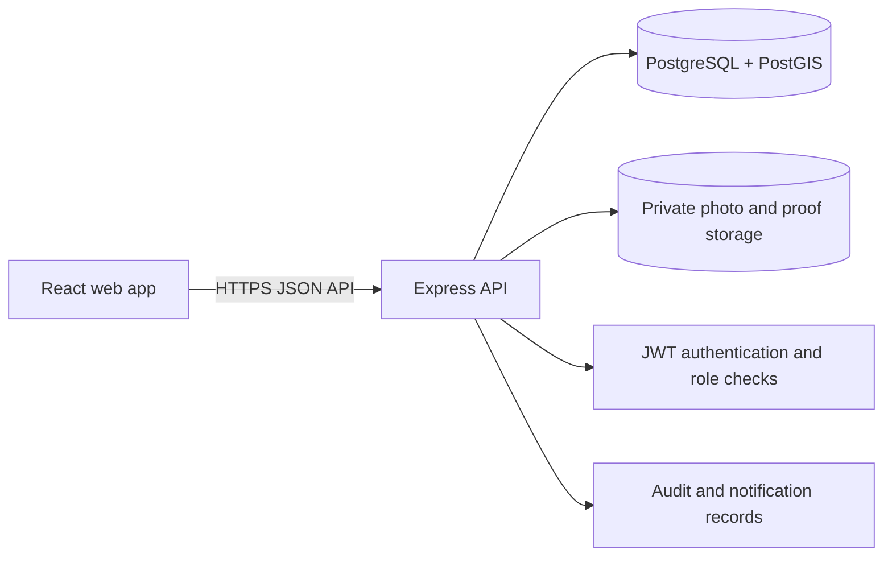
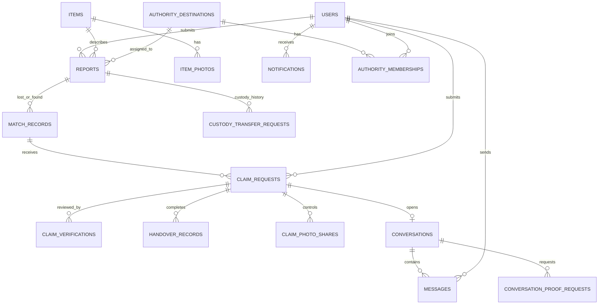

# LostLink

### A secure lost-and-found platform for people, communities, and verified authorities

LostLink helps people report lost and found belongings, discover likely matches, verify ownership, and coordinate a safe return. It combines location-aware matching with private-by-default evidence, claim review, secure messaging, and an optional authority-assisted recovery path.

> **Project:** Database Systems course project
> **Application:** React + Express + PostgreSQL/PostGIS
> **Status:** Full-stack academic project.

---

## What LostLink does

- **Creates lost and found reports** with item details, category, optional location accuracy, and map-based location selection.
- **Finds potential matches** using item information, time, and geographic distance. The matching score is a similarity signal—not proof of ownership—and results below **70/100** are not shown as actionable matches.
- **Protects sensitive information** by keeping item photos private by default and restricting retrieval through authenticated, workflow-aware authorization.
- **Supports ownership claims** with review, verification history, approval/rejection states, and a single-use safe-return code.
- **Offers two recovery paths:** coordinate directly with the finder, or hand the item to an assigned authority for the authority-assisted workflow.
- **Enables claim-linked conversations** with proof requests, private attachments, read state, notifications, and user reporting/moderation.
- **Provides separate workspaces** for administrators and authority members to manage the tasks allowed by their roles.
- **Keeps a return history** so completed recoveries remain recorded after they leave active reports and claims.

## How a recovery works

1. A person submits a **LOST** report; a finder submits a **FOUND** report.
2. LostLink compares eligible reports and presents sufficiently strong candidates to the lost-item owner.
3. The owner submits a claim. The finder or assigned authority reviews ownership evidence and decides whether to approve it.
4. After approval, the claimant receives a private, expiring, single-use safe-return code.
5. The claimant shows the code to the finder or authorized authority at handover. The recipient verifies it to record the return.
6. If authority-assisted recovery was selected, the finder first verifies a separate custody handoff to the assigned authority. The authority then works with the claimant to complete the return.

Photos and proof files are not made public by a match, claim, or conversation. Access is controlled separately and checked by the backend.

## System overview



### Main technologies

| Area | Technology |
| --- | --- |
| Frontend | React, Vite, Leaflet / React-Leaflet |
| Backend | Node.js, Express |
| Database | PostgreSQL, PostGIS, parameterized SQL |
| Authentication | bcrypt password hashes and signed JWTs |
| Private files | Private local storage in development; private object storage in hosted environments |
| Tests | Node.js test runner (`node --test`), integration and frontend unit tests |

## Data model

The database separates account, catalog, report, matching, recovery, conversation, and audit responsibilities. Category-specific attributes are stored separately from shared item fields; photos and proof attachments are represented as private file records.



### Core relational tables

| Domain | Tables | Purpose |
| --- | --- | --- |
| Accounts and catalog | `users`, `items`, `electronics`, `doc_cards`, `accessories`, `item_tags` | User identities and normalized item details |
| Reports and discovery | `reports`, `item_photos`, `match_records` | Lost/found reports, private photos, scored report pairs |
| Claims and recovery | `claim_requests`, `claim_verifications`, `claim_photo_shares`, `handover_records` | Claim lifecycle, reviewer history, explicit photo permissions, claimant handover |
| Authority custody | `authority_destinations`, `authority_memberships`, `custody_transfer_requests` | Verified destinations, authorized membership, separate finder-to-authority custody |
| Communication | `conversations`, `messages`, `conversation_read_states`, `conversation_proof_requests`, `conversation_proof_attachments` | Claim-linked chat, read tracking, and private proof exchange |
| Safety and operations | `chat_user_reports`, `audit_logs`, `notifications` | Moderation records, security audit trail, and user notifications |

The SQL ER diagram is a high-level view. The migration files are the source of truth for all columns, keys, checks, indexes, and triggers.

## Repository layout

```text
backend/
  api/                  API runtime entry point
  src/                  Express app, middleware, config, and route modules
  tests/                Backend unit and integration tests
database/
  migrations/           Ordered PostgreSQL/PostGIS schema migrations
  seeds/                Fictional local demo data
  queries/              Example SQL queries and database checks
frontend/
  src/                  React application, components, and API client
  tests/                Frontend logic and interaction tests
```

## Run locally

### Prerequisites

- Node.js **22.12 or later** (supported major versions: Node 22; see each package's `engines` field).
- PostgreSQL with the **PostGIS** extension enabled.
- `psql` (or a PostgreSQL administration tool such as pgAdmin).

### 1. Create and initialize the database

Create a local development database, then connect to it. Run the migrations **once each, in numerical order**. Migrations `002`–`006` are not intended to be reapplied to an already-migrated database.

```sql
CREATE DATABASE lostlink;
```

From the repository root in PowerShell:

```powershell
psql -U postgres -d lostlink -f database/migrations/001_initial_schema.sql
psql -U postgres -d lostlink -f database/migrations/002_add_stale_match_status.sql
psql -U postgres -d lostlink -f database/migrations/003_claim_photo_sharing.sql
psql -U postgres -d lostlink -f database/migrations/004_authorities_and_custody.sql
psql -U postgres -d lostlink -f database/migrations/005_chat_proof_and_read_receipts.sql
psql -U postgres -d lostlink -f database/migrations/006_chat_user_reports.sql
```

For a disposable local demonstration only, review `database/seeds/001_demo_data.sql` before loading it. Do not seed production with demo accounts or fictional reports. To try the spatial query, run `database/queries/001_test_location_matching.sql` against a database containing the expected sample data.

### 2. Configure and start the backend

```powershell
cd backend
Copy-Item .env.example .env
npm install
npm run dev
```

Edit `backend/.env` with the local database connection and distinct random values for `JWT_SECRET` and `CUSTODY_CODE_HMAC_KEY` (each at least 32 bytes). Keep `.env` private and out of Git. The backend API listens at `http://localhost:5000`; its health endpoint is `http://localhost:5000/api/health`.

### 3. Configure and start the frontend

In a second terminal:

```powershell
cd frontend
Copy-Item .env.example .env
npm install
npm run dev
```

The default frontend API URL is `http://localhost:5000/api`. Open the Vite URL printed by the frontend development server (normally `http://localhost:5173`). The API health URL is for checking the backend; it does not open the frontend.

## Tests and quality checks

Run package scripts from their respective folders:

```powershell
# Backend (integration tests require the isolated test database described by the project setup)
cd backend
npm test

# Frontend
cd ..\frontend
npm test
npm run lint
npm run build
```

The backend and frontend have separate package manifests, so there is no root-level `npm test` command. Do not point integration tests at a production database or a database containing important personal data.

## Privacy and security notes

- Passwords are stored as bcrypt hashes; login uses signed JWTs.
- Production configuration requires secure secrets, HTTPS origins, and validated PostgreSQL TLS. Do not put server secrets in `VITE_*` variables.
- Item photos and claimant proof are private objects. API authorization determines whether an authenticated participant can retrieve a file; a public URL or hidden frontend element is not authorization.
- Claim handover codes and authority custody codes are separate, expiring, single-use workflows. Never log or share raw codes, credentials, JWTs, reviewer notes, private evidence, or storage keys.
- Authority access depends on active database-backed memberships and assignment rules, not merely on a role value in a token.
- Run schema migrations manually after verifying the target database and a recoverable backup. The application does not automatically migrate a database at startup.

## Academic project note

LostLink demonstrates relational database design and normalization alongside a practical full-stack application: spatial matching, role-based workflows, privacy controls, transaction-safe recovery, messaging, and automated tests. Matching scores help prioritize review; a score does not verify that a claimant owns an item.
